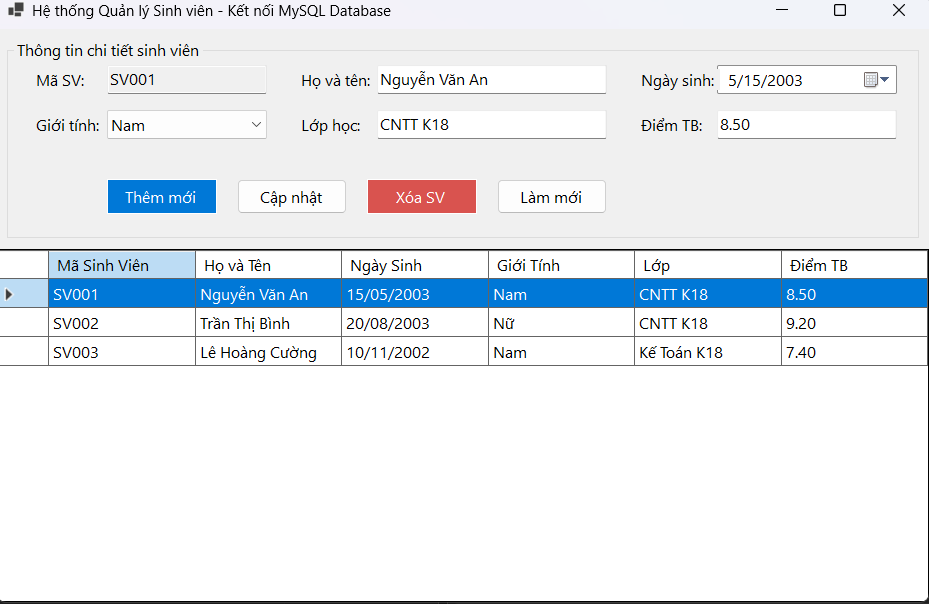
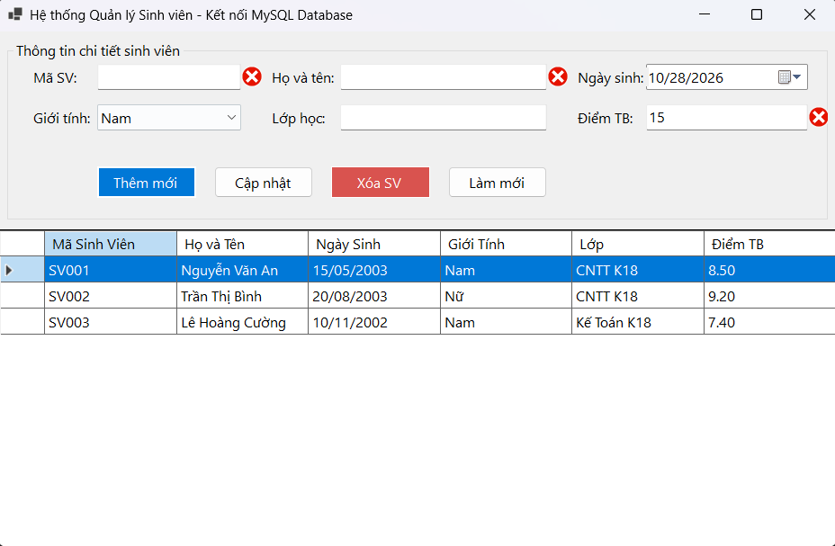
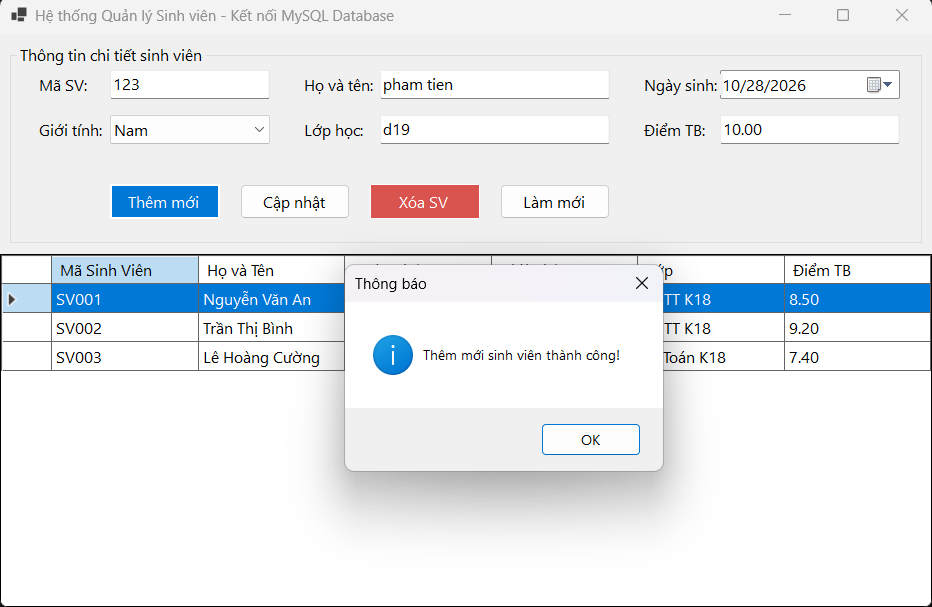

# BÁO CÁO BÀI TẬP THỰC HÀNH LẬP TRÌNH C# WINFORMS - KẾT NỐI CƠ SỞ DỮ LIỆU MYSQL

## I. THÔNG TIN SINH VIÊN

* **Họ và tên:** Lê Quang Hưng
* **Mã số sinh viên:** 24810320237
* **Lớp học phần:** Lập trình .NET - Mã lớp: D19QTANM1
* **Tên bài tập:** Nâng cấp Bài 4.1 và 4.2 lưu trữ vào MySQL (`ql_sinhvien`)

---

## II. THÔNG TIN HỆ THỐNG & CƠ SỞ DỮ LIỆU

* **Hệ quản trị CSDL:** MySQL (host `127.0.0.1`, port `3307`)
* **Cơ sở dữ liệu:** `ql_sinhvien` (`utf8mb4_unicode_ci`)
* **Bảng theo đề:** `SinhVien` (`MaSV`, `HoTen`, `NgaySinh`, `GioiTinh`, `Lop`, `DiemTB`)
* **Bảng bổ sung cho bài:** `TaiKhoan`, `KhoaHoc`, `DangKyHocVien`
* **Công nghệ / thư viện:** C# .NET 10 Windows Forms, `MySql.Data`

---

## III. CÁC TÍNH NĂNG ĐÃ HOÀN THÀNH

### 1. Bài tập 4.1: Form đăng nhập chuẩn UX

* `ErrorProvider` kiểm tra tên đăng nhập và mật khẩu bắt buộc.
* Enter đăng nhập, Esc thoát; `CheckBox` hiện/ẩn mật khẩu.
* Xác thực tài khoản từ bảng `TaiKhoan`, liên kết tới `SinhVien`; mật khẩu dùng PBKDF2-SHA256 kèm salt.
* Tài khoản khởi tạo: `student` / `123456`.

### 2. Bài tập 4.2: Form đăng ký học viên

* Dùng `MaskedTextBox` với mask `(000) 000-0000`, `DateTimePicker` theo `dd/MM/yyyy`, RadioButton và CheckBox.
* ComboBox nạp khóa học từ bảng `KhoaHoc` bằng `DisplayMember` và `ValueMember`.
* Lưu hồ sơ vào `SinhVien`, chi tiết vào `DangKyHocVien` trong cùng một transaction MySQL.

---

## IV. HÌNH ẢNH MINH HỌA MYSQL

Ba ảnh dưới đây do người dùng cung cấp theo repo mẫu, theo thứ tự giao diện, Validation và thêm mới thành công.

### 1. Giao diện chính và dữ liệu đọc từ MySQL



### 2. Bắt lỗi Validation



### 3. Thêm mới thành công



### 4. Ảnh giao diện 4.1/4.2 đã khôi phục

Bốn ảnh form dưới đây đã được khôi phục từ phiên bản trước. Chúng là ảnh giao diện cũ, chụp khi project còn dùng SQL Server.

* [Bài 4.1 — Giao diện đăng nhập](docs/bai4_1_login.png)
* [Bài 4.1 — Validation](docs/bai4_1_error.png)
* [Bài 4.2 — Giao diện đăng ký](docs/bai4_2_main.png)
* [Bài 4.2 — Validation](docs/bai4_2_error.png)

---

## V. HƯỚNG DẪN CÀI ĐẶT & CHẠY

1. Khởi động MySQL.
2. Mở `src/Database/ql_sinhvien.sql` bằng MySQL Workbench hoặc phpMyAdmin và chạy toàn bộ script.
3. Mở `src/WinFormsAppSolution.sln` bằng Visual Studio hoặc chạy từng project bằng `dotnet run`.
4. Mặc định kết nối `127.0.0.1:3307`, user `root`, mật khẩu trống. Có thể tùy chỉnh qua biến môi trường `BAITAP_MYSQL_SERVER`, `BAITAP_MYSQL_PORT`, `BAITAP_MYSQL_USER`, `BAITAP_MYSQL_PASSWORD`.

---

## VI. CẤU TRÚC REPOSITORY

```
LTNet-28-10-2026_24810320237_LeQuangHung/
├── .gitignore
├── README.md
├── docs/
│   ├── bai_db_ui.png
│   ├── bai_db_error.png
│   ├── bai_db_result.png
│   ├── bai4_1_login.png
│   ├── bai4_1_error.png
│   ├── bai4_2_main.png
│   └── bai4_2_error.png
└── src/
    ├── WinFormsAppSolution.sln
    ├── BaiTap4.1-Login/
    ├── BaiTap4.2-DangKy/
    └── Database/ql_sinhvien.sql
```

* `src/WinFormsAppSolution.sln`: solution mở bằng Visual Studio.
* `src/BaiTap4.1-Login/`: ứng dụng đăng nhập.
* `src/BaiTap4.2-DangKy/`: ứng dụng đăng ký học viên.
* `src/Database/ql_sinhvien.sql`: script MySQL tạo CSDL, bảng và ba dòng sinh viên mẫu theo đề bài.
* `docs/`: ba ảnh MySQL tham khảo bạn cung cấp theo mẫu README.
