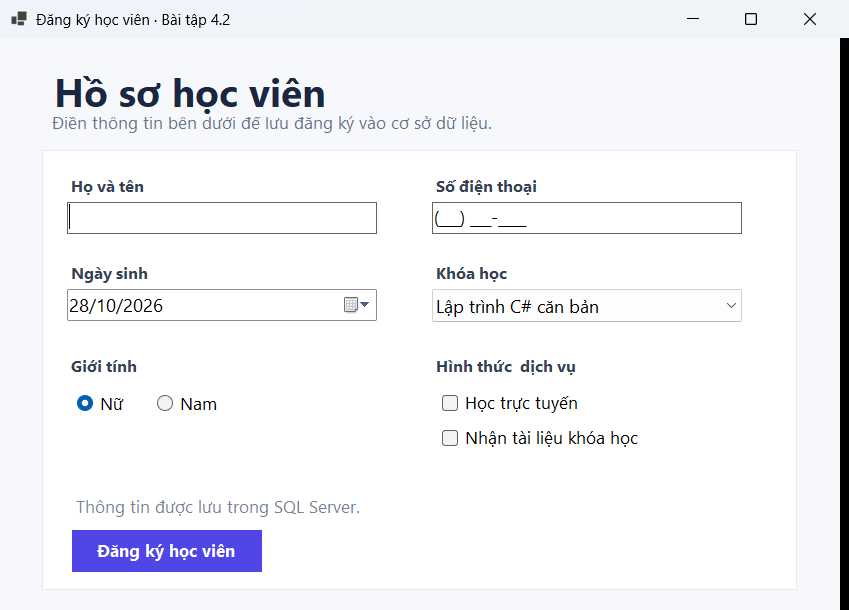
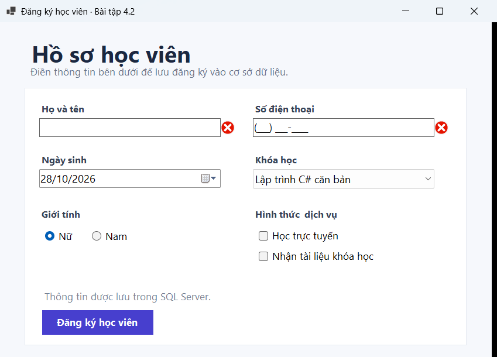

# BÁO CÁO BÀI TẬP THỰC HÀNH LẬP TRÌNH C# WINFORMS

## I. THÔNG TIN SINH VIÊN
* **Họ và tên:** Lê Quang Hưng
* **Mã số sinh viên:** 24810320237
* **Lớp học phần:** Lập trình .NET - Mã Lớp: d19qtanm1

* **Link Repository:** https://github.com/hunglq24810320237/LTNet-28-10-2026_24810320237_LeQuangHung

---

## II. NỘI DUNG BÀI TẬP
* **Bài tập 4.1:** Xây dựng Form đăng nhập chuẩn UX và xác thực tài khoản từ SQL Server.
* **Bài tập 4.2:** Xây dựng Form đăng ký học viên, binding danh sách khóa học và lưu hồ sơ vào SQL Server.

---

## III. MINH HỌA GIAO DIỆN & KỸ THUẬT NỔI BẬT

### 1. Bài 4.1: Xây dựng Form Đăng nhập (Login Form)
* **Kỹ thuật áp dụng:** `ErrorProvider` kiểm tra tên đăng nhập và mật khẩu; `AcceptButton` / `CancelButton` cho phím Enter và Esc; `UseSystemPasswordChar` để hiện/ẩn mật khẩu.
* **Lưu trữ CSDL:** SQL Server tạo database `BaiTap41Login`, bảng `dbo.Users`; tài khoản được truy vấn để xác thực, mật khẩu lưu dưới dạng PBKDF2-SHA256 có salt.
* **Tài khoản mẫu:** `student` / `123456` (được khởi tạo khi chạy ứng dụng lần đầu).
* **Hướng dẫn chạy:** [BaiTap4.1-Login/README.md](BaiTap4.1-Login/README.md)

* **Hình ảnh minh họa giao diện:**

*Mô tả: Form đăng nhập với trường tên đăng nhập, mật khẩu, tùy chọn hiện mật khẩu và các nút thao tác.*

*Mô tả: ErrorProvider hiển thị lỗi khi để trống tên đăng nhập và mật khẩu.*

---

### 2. Bài 4.2: Form Đăng ký Học viên
* **Kỹ thuật áp dụng:** `MaskedTextBox` với mask `(000) 000-0000`, `DateTimePicker` định dạng `dd/MM/yyyy`, `ComboBox` binding qua `DisplayMember` / `ValueMember`, `RadioButton` chọn giới tính và `CheckBox` chọn hình thức học / tài liệu.
* **Lưu trữ CSDL:** SQL Server database `BaiTap42Registration` dùng bảng `dbo.Courses` cho danh sách khóa học và bảng `dbo.Registrations` để lưu hồ sơ, liên kết bằng khóa ngoại `CourseId`.
* **Kết quả:** Kiểm tra dữ liệu bắt buộc, lưu đăng ký, hiển thị thông tin và mã đăng ký trên `MessageBox`.
* **Hướng dẫn chạy:** [BaiTap4.2-DangKy/README.md](BaiTap4.2-DangKy/README.md)

* **Hình ảnh minh họa giao diện:**

*Mô tả: Form đăng ký với thông tin cá nhân, danh sách khóa học đã nạp từ SQL Server và các lựa chọn đăng ký.*

*Mô tả: ErrorProvider yêu cầu nhập họ tên và số điện thoại theo đúng mask.*

---

### Cấu hình và chạy chương trình
* **Công nghệ:** C# Windows Forms, .NET 10, Microsoft SQL Server.
* **Yêu cầu:** Windows, .NET 10 SDK và SQL Server (mặc định `localhost\SQLEXPRESS`).
* Hai script tạo database và bảng có trong thư mục [`Database`](Database/).

